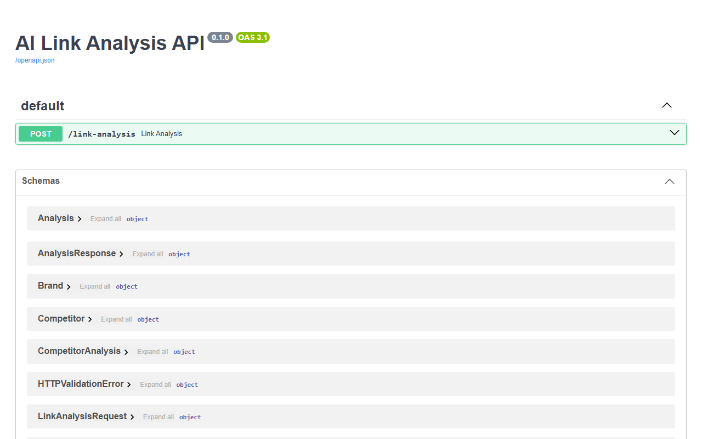

# AI Link Analysis API

FastAPI service: `POST /link-analysis` takes a website URL, extracts its content, makes **one** LLM call, and returns five analysis sections (competitors, search queries, SEO, top services, target audience) as validated JSON.

## Setup
```bash
python -m venv .venv && .venv\Scripts\activate      # Windows
pip install -r requirements.txt
cp .env.example .env                                  # edit as needed
ollama pull mistral                                   # or any model; set OLLAMA_MODEL
uvicorn app.main:app --host 0.0.0.0 --port 4000
```
Docs: http://localhost:4000/docs · Tests: `pytest` · Benchmark: `python -m scripts.benchmark https://www.python.org`

Config (env / `.env`): `LLM_PROVIDER` (`ollama` default | `gemini`), `OLLAMA_URL`, `OLLAMA_MODEL`, `GEMINI_API_KEY`, `GEMINI_MODEL`. If a Gemini key is set, the non-primary provider is used as automatic fallback. Keys are read only from the environment; `.env` is git-ignored.

## How it works
1. Validate URL (http/https only) and **SSRF-guard** it: every host (and every redirect hop, followed manually, max 3) must resolve only to public IPs; response size capped at 2 MB, 10 s timeout.
2. Fetch homepage + up to 2 same-site about/services/product pages; strip scripts/nav/footer, drop duplicate lines, keep title, meta description, headings, text; capped at ~9k chars (~2.5k tokens).
3. One schema-constrained LLM call (Ollama `format` / Gemini `responseJsonSchema`) returns all five sections; output is validated with Pydantic (5 queries, 5 services, ≥3 competitors). Invalid output or provider error → fallback provider → else HTTP 503.
4. **Competitor verification (no extra LLM call):** each suggested competitor's homepage is fetched (title/meta/headings only). Success → `source: "verified_from_website"` with `verified_summary`; otherwise `source: "ai_suggested"`. Competitors are AI suggestions unless verified; services carry `inferred: true` when not stated on the site. No search volumes are produced.
5. Results cached in memory per URL (1 h TTL).

Errors: `422` invalid URL / non-HTML, `400` private/internal address, `502` unreachable site, `504` site timeout, `503` LLM failure. Body: `{"success": false, "error": "..."}`.

## Sample
```bash
curl -X POST localhost:4000/link-analysis -H "content-type: application/json" -d '{"url":"https://www.python.org"}'
```
Full real response: [`scripts/sample_response.json`](scripts/sample_response.json) (produced with `mistral:latest` via Ollama). Excerpt:
```json
{"success": true, "website": "https://www.python.org/",
 "brand": {"name": "Python", "category": "Programming Language", "summary": "The official home of the Python Programming Language"},
 "analysis": {"competitor_analysis": {"competitors": [{"name": "C++", "website": "https://isocpp.org/", "source": "verified_from_website", "...": "..."}]}}}
```

## LLM research

### Measured (this repo, `scripts/benchmark.py`, local machine)
| Site | Model | Input tok | Output tok | Time |
|---|---|---|---|---|
| python.org | Ollama `mistral:latest` (7B, Q4) | 1570 | 2129 | 56.9 s |
| basecamp.com | Ollama `mistral:latest` | 1913 | 2274 | 50.4 s |
| python.org | Gemini `gemini-2.5-flash` | 1429 | 1835 | 22.1 s |
| basecamp.com | Gemini `gemini-2.5-flash` | 1759 | 1565 | 20.6 s |

Takeaways: input is only ~1.4–1.9k tokens after cleaning, **output (~1.6–2.3k) dominates** cost and time. Gemini 2.5 Flash was ~2.5x faster than local Mistral 7B. Gemini's reported output tokens exclude any internal thinking tokens, which are billed as output, so real cost is somewhat higher. OpenAI and Anthropic models were **not benchmarked**, and **no accuracy benchmark was run**; no accuracy claims are made. All four runs passed schema validation first try.

### Comparison (prices per 1M tokens, from third-party aggregators that cite provider pages, found Nov 2026 — confirm on the official pricing pages before relying on them)
| Provider | Model | Input / Output | Speed | Context | JSON | Cost for ~2k in / 2.5k out |
|---|---|---|---|---|---|---|
| Ollama (local) | mistral 7B (measured) | free (own hardware) | **measured ~55 s** | 32k | schema-constrained `format` | $0 |
| Google | Gemini 2.5 Flash | $0.30 / $2.50 ([source](https://www.kunalganglani.com/llm-prices/gemini-2.5-flash)) | **measured ~21 s** | ~1M | native JSON schema | ≈ $0.005 (+ thinking tokens) |
| Anthropic | Claude Haiku 5.5 | $0.10 / $0.50 for ≤100k prompts ([source](https://docs.kanaries.net/articles/haiku-pricing)) | est. fast (not measured) | large | via tool use | ≈ $0.0015 |
| OpenAI | GPT-5.4 mini | $0.75 / $4.50 ([source](https://pricepertoken.com/pricing-page/model/openai-gpt-5.4-mini)) | est. fast (not measured) | large | Structured Outputs | ≈ $0.013 |

Cost formula: `in/1e6*price_in + out/1e6*price_out` using the measured token counts. Aggregator prices disagree in places; treat as estimates.

### Recommendation
- **Primary: Ollama local model** — zero API cost, schema-constrained JSON worked reliably; slower (~1 min) on this hardware. Use a stronger local/Ollama-hosted model if quality is lacking.
- **Fallback / fast path: Gemini 2.5 Flash** (≈ $0.005 per analysis, measured ~21 s, native JSON schema, huge context, free tier) — configured via `GEMINI_API_KEY`, used automatically if Ollama fails, or set `LLM_PROVIDER=gemini` for speed.
- Expected: ~1.5–1.9k input + ~1.6–2.3k output tokens per analysis.

### Cost optimisation (implemented)
Cleaned text instead of raw HTML and de-duplication; ~9k-char cap; at most 3 pages; **a single call for all five sections** (page is sent once); terse prompt, with field descriptions living in the schema; schema-constrained output avoids retry calls; competitor verification uses plain HTTP fetches, not the LLM; per-URL cache; small/local model by default with fallback only on failure.

## Screenshots / logs (`docs/`)
- Swagger UI at `/docs`: 
- Successful analysis (Gemini, python.org, HTTP 200): [`docs/request_success.txt`](docs/request_success.txt)
- Private address blocked (SSRF, HTTP 400): [`docs/error_private_url.txt`](docs/error_private_url.txt)
- Invalid URL (HTTP 422): [`docs/error_invalid_url.txt`](docs/error_invalid_url.txt)
- Unresolvable domain (HTTP 502): [`docs/error_unreachable.txt`](docs/error_unreachable.txt)
- Tests: [`docs/pytest.txt`](docs/pytest.txt) · Benchmark: [`docs/benchmark.txt`](docs/benchmark.txt) · Server log: [`docs/server.log`](docs/server.log)
